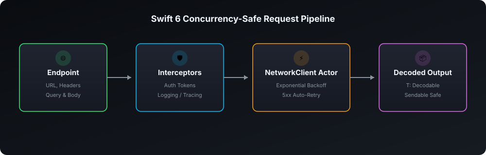

# ModernNetworking 🌐

A type-safe, Swift 6 async/await HTTP networking client with automatic exponential backoff retries, request interceptors, and strict concurrency safety.

[](https://github.com/nilkanthdesai76/swift-modern-networking/actions)
[](https://swift.org)
[](https://developer.apple.com)
[](https://swift.org/package-manager/)
[](LICENSE)

<p align="center">
  
</p>

---

## Features

- ⚡ **Swift Concurrency Native**: Built entirely around `actor`, `async/await`, and `Sendable`. Zero completion handlers.
- 🔄 **Intelligent Retry Policy**: Automatic exponential backoff for transient network drops and server 5xx errors.
- 🛡️ **Request Interceptors**: Clean pipeline for attaching bearer authentication tokens, API keys, or custom logging.
- 🎯 **Protocol-Oriented Endpoints**: Cleanly encapsulate paths, HTTP methods, headers, and query parameters.
- 📦 **Type-Safe Decoding**: Directly decodes JSON payloads into strongly typed `Decodable & Sendable` models.

---

## Installation

Add **ModernNetworking** to your `Package.swift`:

```swift
dependencies: [
    .package(url: "https://github.com/nilkanthdesai76/swift-modern-networking.git", from: "1.0.0")
]
```

---

## Usage

### 1. Define an Endpoint

```swift
import Foundation
import ModernNetworking

struct UserProfileEndpoint: Endpoint {
    let userId: String

    var baseURL: URL { URL(string: "https://api.example.com")! }
    var path: String { "v1/users/\(userId)" }
    var method: HTTPMethod { .get }
    var headers: [String: String]? { ["Accept": "application/json"] }
}
```

### 2. Configure Interceptors & Execute

```swift
import ModernNetworking

// Attach authentication interceptor
let authInterceptor = HeaderInterceptor(headers: [
    "Authorization": "Bearer YOUR_JWT_TOKEN"
])

let client = NetworkClient(interceptors: [authInterceptor])

do {
    let profile: UserProfile = try await client.send(
        UserProfileEndpoint(userId: "42"),
        retryPolicy: .standard
    )
    print("Welcome \(profile.name)")
} catch {
    print("Network failure: \(error.localizedDescription)")
}
```

---

## License

This project is licensed under the MIT License - see the [LICENSE](LICENSE) file for details.
